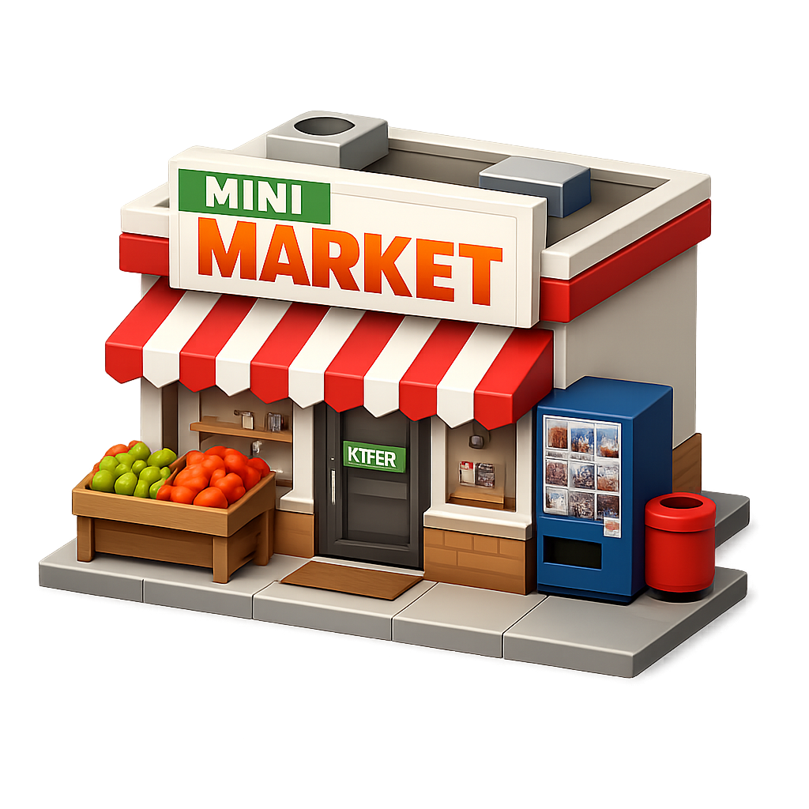
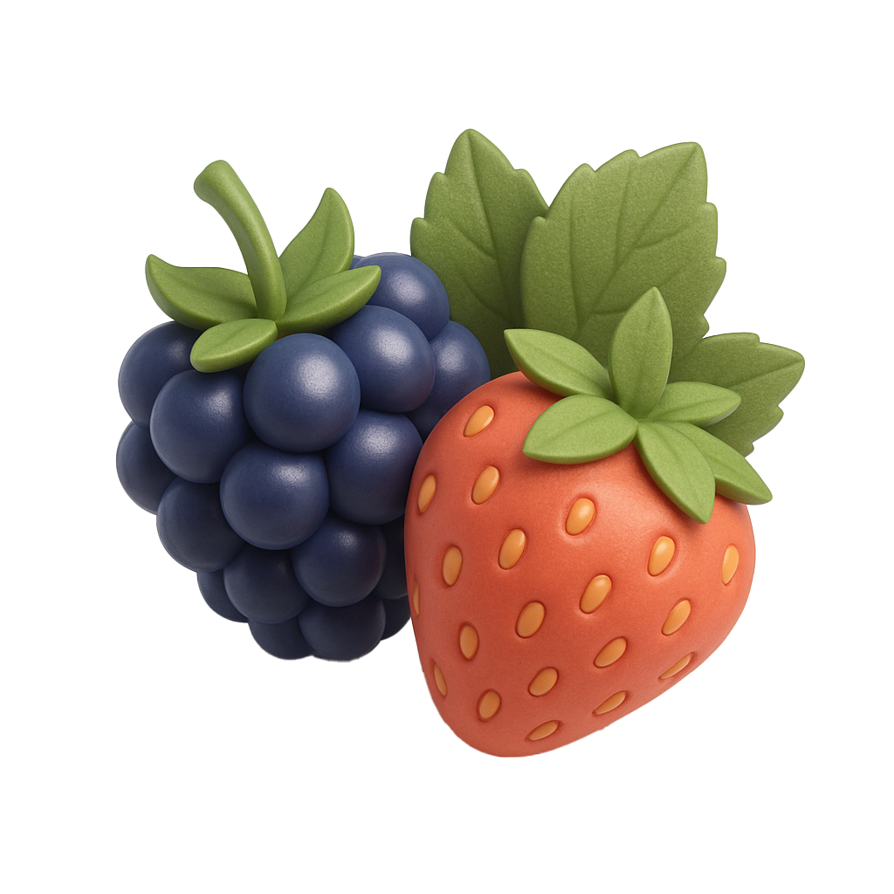
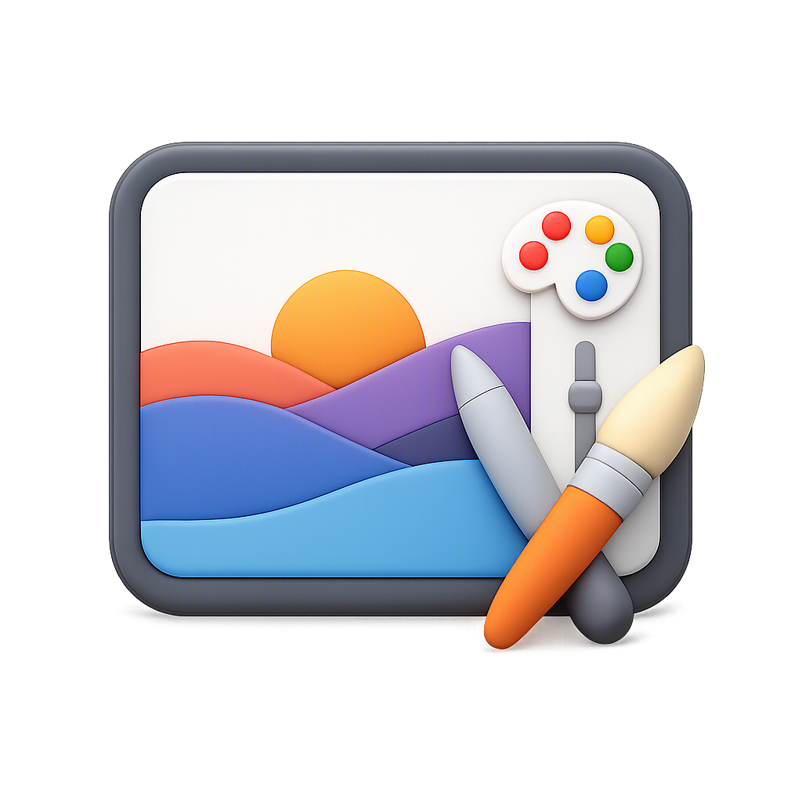
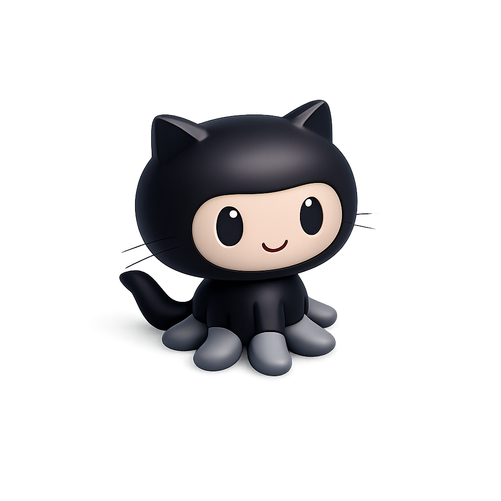
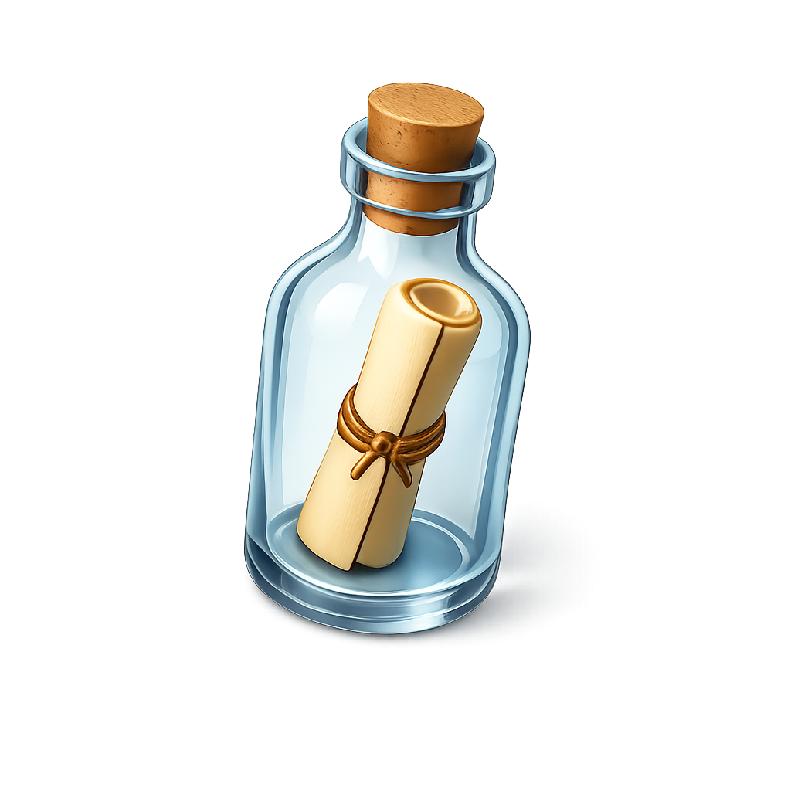

 

---

##  Стек

**Языки и фреймворки**  

**Базы данных**  

**Инфраструктура**  

**Тестирование и качество**  

**Мониторинг**  

**Дополнительно**  

`AI-интеграция:` OpenAI-compatible API · LM Studio · OpenRouter · Prompt Engineering  
`AI-ассистенты:` DeepSeek · QwenCoder · AI-assisted Development  
`Архитектура:` Clean Architecture · Repository · Unit of Work · DI

---

##  Избранные проекты

###  [episodio](https://github.com/EvgenySkorik/episodio)
Личный кино-трекер для VK. Асинхронный бэкенд, кеширование, мониторинг.  
`FastAPI` `PostgreSQL` `Redis` `Celery` `Docker` `Grafana` `Prometheus`

###  [megano-store](https://github.com/EvgenySkorik/megano-store)
Дипломный проект интернет-магазина. Полный стек: бэкенд + фронтенд + инфраструктура.  
`Django` `DRF` `Vue.js` `Docker` `PostgreSQL`

###  [wb-categories-api](https://github.com/EvgenySkorik/wb-categories-api)
Асинхронный API для работы с категориями Wildberries. Планировщик синхронизации.  
`FastAPI` `SQLAlchemy` `PostgreSQL` `Async`

###  [Art_room_tg_bot](https://github.com/EvgenySkorik/Art_room_tg_bot)
Телеграм-бот для дизайн-студии. Портфолио, услуги, заявки.  
`Python` `pyTelegramBotAPI`

---

##  GitHub Stats

---

##  Связаться со мной

---

> «Код — это поэзия. Просто с отступами и без рифмы.»
